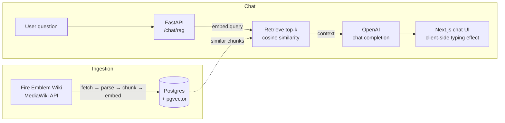

# Forsetiemblem

Forsetiemblem is a Fire Emblem RAG application. It ingests chapter data from the Fire Emblem wiki, stores structured content in Postgres with pgvector embeddings, and serves a chat-focused UI that answers chapter questions using retrieval-augmented generation.

| Part | What it does | Stack |
| ---- | ------------ | ----- |
| `backend/` | FastAPI service: wiki ingestion, RAG retrieval, chat API | FastAPI, SQLAlchemy, Postgres + pgvector, Redis, OpenAI |
| `frontend/` | Chat UI, chapters list, informational pages | Next.js 15, React 19, Tailwind CSS, TypeScript |
| `infrastructure/` | Docker Compose and Cloud Build / Cloud Run configs | Docker, Google Cloud |

## How It Works



1. **Ingestion** — the backend fetches a chapter page from the wiki, parses it into structured records (infobox, summary, sections), splits them into chunks, optionally embeds them with OpenAI, and stores everything in Postgres + pgvector.
2. **Chat** — a user question is embedded, similar chunks are retrieved via pgvector cosine distance, and the retrieved context is sent to OpenAI to generate the answer. Sources are returned alongside the answer.

## Quick Start (Local, No Docker)

This is the recommended way to run the project right now (see the [Docker note](#running-with-docker) below for why).

### Prerequisites

- **Python 3.11+**
- **Node.js 18+** and npm
- **Docker** (only to run Postgres/pgvector and Redis)
- **An OpenAI API key** (embeddings + chat)
- Bash (Git Bash on Windows, or WSL) for the helper scripts

### 1. Start the services

Postgres with pgvector and Redis are the two backing services. The quickest way is Docker:

```bash
docker run -d --name forsetiemblem-db \
  -e POSTGRES_USER=postgres -e POSTGRES_PASSWORD=postgres -e POSTGRES_DB=forsetiemblem \
  -p 5432:5432 pgvector/pgvector:pg16

docker run -d --name forsetiemblem-redis -p 6379:6379 redis:7
```

> **Redis is required for chat endpoints.** Rate limiting runs through Redis; if `REDIS_URL` is not reachable, chat routes return 500. Postgres must have the `vector` extension available (the `pgvector/pgvector` image includes it).

### 2. Configure the backend

```bash
cd backend
cp .env.example .env
```

Edit `backend/.env`:

| Variable | Must change? | Notes |
| -------- | ------------ | ----- |
| `OPENAI_API_KEY` | **Yes** | Required for embeddings and chat |
| `DATABASE_URL` | Only for a non-local DB | Default points at the local Docker Postgres |
| `REDIS_URL` | Only for a non-local Redis | Default `redis://localhost:6379/0` |
| `CORS_ALLOWED_ORIGIN` | Only for a different frontend origin | Default `http://localhost:3000` |
| `TURNSTILE_SECRET_KEY` | Optional | Set `TURNSTILE_ENABLED=false` if you don't have a key |

See `backend/.env.example` for the full annotated list (rate limits, cost controls, docs auth).

### 3. Set up and run the backend

```bash
cd backend
python -m venv .venv
source .venv/Scripts/activate   # Windows Git Bash
# source .venv/bin/activate     # Linux / macOS
pip install -r requirements.txt

bash start.sh
```

`backend/start.sh` loads `.env`, runs Alembic migrations (`alembic upgrade head`), and starts the FastAPI dev server at **http://localhost:8000**. Full backend setup, commands, and troubleshooting: [backend/README.md](backend/README.md).

Verify with:

```bash
curl http://localhost:8000/health
```

The response reports database connection and pgvector availability.

### 4. Configure and run the frontend

```bash
cd frontend
npm install
cp .env.example .env.local
npm run dev
```

Open **http://localhost:3000**. The frontend expects the backend at `NEXT_PUBLIC_API_URL` (default `http://localhost:8000`). Full frontend setup and commands: [frontend/README.md](frontend/README.md).

Or run everything at once from the repo root:

```bash
bash start.sh
```

This starts the frontend and backend in two shells (requires Git Bash on Windows).

### 5. Ingest a chapter

The chat has nothing to answer until at least one chapter is ingested. Ingest from the wiki by page title (URL-encoded):

```bash
curl -X POST "http://localhost:8000/wiki/page/Prologue%20(Blazing%20Blade)/ingest?generate_embeddings=true"
```

Then check http://localhost:3000/chapters or `curl http://localhost:8000/chapters`. See [documentation/backend.md](documentation/backend.md#ingestion) for more ingestion options (`/reingest`, category listing, wikitext parsing).

## Running With Docker

```bash
cp backend/.env.example backend/.env   # required: the api service loads this file
docker compose -f infrastructure/compose/local.dev.yml up --build
```

> **Note:** the Compose file's `api` service builds from `backend/Dockerfile.dev`, which does **not currently exist** in this repository, so the API container build will fail. Until it is added, use the [local quick start](#quick-start-local-no-docker) above (the `db` service alone works fine, or run the Postgres/Redis containers manually as shown there). Also note Compose does **not** include a Redis service.

| Service | URL |
| ------- | --- |
| Frontend | http://localhost:3000 |
| Backend API | http://localhost:8000 |
| API docs | http://localhost:8000/docs (auth-protected when enabled) |
| Postgres | localhost:5432 (`postgres`/`postgres`, db `forsetiemblem`) |

## Resetting the Database

```bash
bash resetdb.sh
```

> **Warning:** this drops and recreates the database. All ingested chapters are lost. It requires the Postgres container to be running. Afterwards, restart the backend so migrations recreate the tables, and re-ingest chapters.

## Documentation

- [Backend setup guide](backend/README.md) — backend installation, commands, migrations, troubleshooting
- [Frontend setup guide](frontend/README.md) — frontend installation, commands, troubleshooting
- [Backend documentation](documentation/backend.md) — backend architecture, API reference, ingestion, RAG internals
- [Frontend documentation](documentation/frontend.md) — frontend architecture, chat flow, design decisions
- [API docs (Swagger)](http://localhost:8000/docs) — live, generated from the running backend

## Testing

```bash
# Backend unit tests (rate limits, cost controls, session quotas)
cd backend && pytest

# Frontend checks
cd frontend
npm run lint
npm run type-check
```

## Disclaimer

Forseti Emblem is a non-commercial, open-source technical demonstration developed for portfolio and educational purposes.

- **Data source**: Textual content is retrieved from the [Fire Emblem Wiki](https://fireemblem.fandom.com/) via the MediaWiki API and is used under the terms of the CC BY-SA 3.0 license.
- **Ownership**: Fire Emblem and all associated characters, names, and lore are the intellectual property of Nintendo and Intelligent Systems. This project is not affiliated with, endorsed by, or sponsored by Nintendo or Intelligent Systems.
- **Purpose**: This repository showcases Retrieval-Augmented Generation (RAG) architecture and vector database implementation. It is not intended to replace official sources or to generate revenue.
- **Rights holders**: If you are a rights holder and have concerns regarding how this codebase or any live demonstration based on it uses your content, please reach out so we can discuss and address them appropriately. You can contact me at `rkvilena11@gmail.com` or via issues on the GitHub repository for this project.
