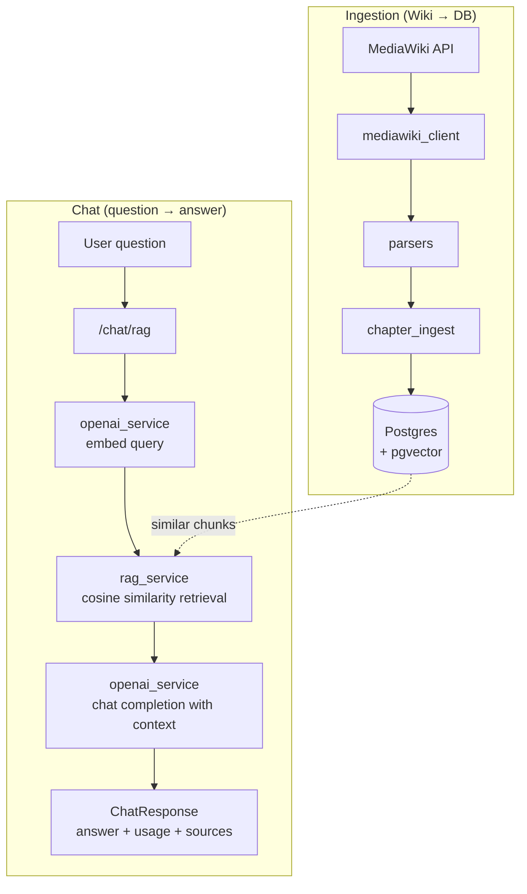

# Backend Documentation

The backend is a FastAPI service that ingests Fire Emblem chapter data from the Fire Emblem wiki, stores it in Postgres with pgvector embeddings, and exposes the chat and ingestion APIs used by the frontend.

This document covers how the backend works: architecture, pipelines, data model, the API contract, security design, and operational behavior.

> **Looking to install or run the backend?** See [backend/README.md](../backend/README.md) for setup, commands, migrations, and troubleshooting.

## Contents

1. [Architecture](#architecture)
2. [Project Layout](#project-layout)
3. [Configuration Model](#configuration-model)
4. [API Reference](#api-reference)
5. [Ingestion](#ingestion)
6. [RAG Internals](#rag-internals)
7. [Security and Limits](#security-and-limits)
8. [Operational Notes](#operational-notes)

## Architecture



### High-level flows

**Ingestion (Wiki → DB)**

1. The MediaWiki client fetches page HTML or wikitext.
2. Parsers extract the infobox, summary, sections, and tables.
3. Ingestion builds `Chapter` and `ChapterChunk` records.
4. Embeddings are created via OpenAI (optional; requires `OPENAI_API_KEY`).
5. Records are stored in Postgres; pgvector holds the embeddings.

**RAG chat (User → Answer)**

1. The endpoint validates message length, Turnstile, and rate limits.
2. The query is embedded with OpenAI.
3. Similar `ChapterChunk` rows are retrieved via pgvector cosine distance.
4. A bounded context string is built from chunk content + metadata.
5. An OpenAI chat completion generates the answer.
6. The response returns with model usage and filtered sources.

### Key modules

| Module | Responsibility |
| ------ | -------------- |
| `backend/app/main.py` | FastAPI app, CORS, docs auth, `/health` and `/config` |
| `backend/app/config.py` | Pydantic Settings loaded from `backend/.env` |
| `backend/app/routes/` | `chat.py` and `wiki.py` endpoint definitions |
| `backend/app/controllers/` | Orchestrates chat and ingestion flows |
| `backend/app/schemas/` | Pydantic request/response models |
| `backend/app/models.py` | `Chapter` and `ChapterChunk` SQLAlchemy tables |
| `backend/app/db.py` | SQLAlchemy setup, connectivity check, pgvector init |
| `backend/app/mediawiki_client.py` | MediaWiki API client |
| `backend/app/parsers.py` | HTML/wikitext parsing (infobox, sections, tables) |
| `backend/app/chapter_ingest.py` | Builds DB records and embeddings |
| `backend/app/rag_service.py` | Retrieval and context building |
| `backend/app/openai_service.py` | Embeddings and chat completions |
| `backend/app/rate_limit.py` | IP limits, session quotas, cooldowns (Redis) |
| `backend/app/security/turnstile.py` | Cloudflare Turnstile verification |
| `backend/app/docs_auth.py` | Protects `/docs` and `/redoc` |

### Data model

**Chapter**

- `pageid`, `title`, `infobox_title`, `game`, `objective`, `units_allowed`, `units_gained`, `boss`
- `source_url` and `raw_infobox` (JSON)

**ChapterChunk**

- `chapter_id`, `section_title`, `kind` (summary / infobox / section), `chunk_index`, `text`, `embedding`
- Unique constraint per `(chapter, kind, chunk_index)`

## Configuration Model

Configuration lives in `backend/app/config.py` (Pydantic Settings) and is loaded from `backend/.env` — that file is always preferred, regardless of the working directory where the server is started.

How to create `.env` and which values to set is covered in [backend/README.md](../backend/README.md). This section explains the design of the configuration itself:

- **`DATABASE_URL` is the single source of truth** for the database connection, used by both the app and Alembic. `postgres://` and `postgresql://` URLs are auto-normalized to the psycopg driver. The individual `DATABASE_HOST`/`DATABASE_PORT`/… variables are legacy and ignored.
- **Environment tiers**: `ENVIRONMENT` (`local` / `development` / `staging` / `production`) controls defaults such as reload and docs-auth enforcement.
- **Cost controls are server-side**: `REQUEST_MAX_CHARS` caps chat message length and `RAG_TOP_K_MAX` clamps retrieval `top_k`, regardless of what the client sends.
- **Schema safety net**: Alembic migrations are the source of truth for the schema; an `init_db()` call at app startup additionally attempts to create the `vector` extension and tables as a fallback.

## API Reference

All request bodies are JSON. Chat endpoints enforce, in order: non-empty message, `REQUEST_MAX_CHARS` (400), IP rate limits and session quotas/cooldowns via Redis (429), then Turnstile (400/403/500) when enabled.

### System

| Method | Path | Description |
| ------ | ---- | ----------- |
| GET | `/health` | Status, environment, DB connection, pgvector availability |
| GET | `/config` | Non-sensitive configuration for debugging |

### Chat

#### `POST /chat` — plain chat (no RAG)

```json
{
  "message": "Tell me about Fire Emblem chapters",
  "system_prompt": null,
  "context": null,
  "temperature": 0.3,
  "turnstile_token": "..."
}
```

`system_prompt`, `context`, and `turnstile_token` are optional (`turnstile_token` required when Turnstile is enabled).

#### `POST /chat/rag` — RAG chat (used by the frontend)

```json
{
  "message": "Who is the boss of Chapter 3?",
  "top_k": 8,
  "temperature": 0.3,
  "system_prompt": null,
  "turnstile_token": "..."
}
```

`top_k` (1–30) is clamped down to `RAG_TOP_K_MAX` server-side.

**Response (both endpoints), `ChatResponse`:**

```json
{
  "response": "The boss of Chapter 3 is ...",
  "model": "gpt-4o-mini",
  "usage": {
    "prompt_tokens": 950,
    "completion_tokens": 120,
    "total_tokens": 1070
  },
  "sources": [
    {
      "title": "Chapter 3: The Saders",
      "infobox_title": "Chapter 3",
      "game": "Fire Emblem: The Blazing Blade",
      "pageid": 12345,
      "source_url": "https://fireemblem.fandom.com/wiki/Chapter_3:_The_Saders"
    }
  ]
}
```

Sources are filtered to only return chapters whose title or game appears in the user message.

**Common error responses:**

| Status | Cause |
| ------ | ----- |
| 400 | Empty message, message over `REQUEST_MAX_CHARS`, missing Turnstile token |
| 403 | Turnstile verification failed |
| 429 | Rate limit / session quota exceeded or cooldown active |
| 500 | OpenAI failure, missing `OPENAI_API_KEY`, missing `REDIS_URL`, Turnstile misconfigured |

### Wiki and Ingestion

| Method | Path | Key query params | Description |
| ------ | ---- | ---------------- | ----------- |
| GET | `/wiki/category/{category_name}` | `limit` (1–100), `include_html`, `as_markdown`, `raw` | Fetch category pages, optionally with parsed tables |
| GET | `/wiki/page/{title}` | `include_html`, `raw` | Parse chapter fields from HTML |
| GET | `/wiki/page/{title}/wikitext` | `raw` | Parse summary, infobox, sections from wikitext |
| POST | `/wiki/page/{title}/ingest` | `generate_embeddings` (default true) | Fetch, parse, and store a chapter + chunks |
| POST | `/wiki/page/{title}/reingest` | `generate_embeddings` (default true) | Rebuild chapter and chunks for an existing page |
| GET | `/chapters` | — | List all ingested chapters grouped by game |

`{title}` must match the wiki page title exactly and be URL-encoded, e.g. `Prologue%20(Blazing%20Blade)`.

## Ingestion

Minimum working example:

```bash
curl -X POST "http://localhost:8000/wiki/page/Prologue%20(Blazing%20Blade)/ingest?generate_embeddings=true"
```

Response (`WikiIngestResponse`) includes the `chapter_id` and `chunks_count`.

Practical notes:

- **`generate_embeddings=true` requires `OPENAI_API_KEY`.** With `false`, chunks are still stored but without embeddings — they won't be retrievable by RAG until re-ingested with embeddings.
- **`/ingest` vs `/reingest`**: use `/ingest` for new pages; use `/reingest` to rebuild an already-stored chapter (e.g. after parser changes).
- Embeddings are generated in batches; a batch failure stores the chunk without an embedding rather than aborting ingestion.
- Verify results with `GET /chapters`, or through the frontend at `/chapters`.

## RAG Internals

- Chunks are created from the summary, infobox fields, and individual section lines.
- Retrieval embeds the user message and orders `ChapterChunk` rows by pgvector cosine distance (ascending), limited by `top_k`.
- `rag_service` builds a bounded context string from retrieved chunks plus metadata, so prompt size stays controlled.
- `chat_controller` runs the completion and filters `sources` to chapters whose title or game appears in the user message.

## Security and Limits

| Control | Where | Behavior |
| ------- | ----- | -------- |
| Message length | `routes/chat.py` + `REQUEST_MAX_CHARS` | 400 when exceeded |
| `top_k` clamp | `routes/chat.py` + `RAG_TOP_K_MAX` | Silently clamped |
| IP rate limit | `rate_limit.py` + Redis | Short window (burst) and long window (daily cap) per IP; 429 when exceeded |
| Session quota | `rate_limit.py` + Redis | Anonymous session cookie with its own long-window quota |
| Session cooldown | `rate_limit.py` + Redis | After `SESSION_COOLDOWN_THRESHOLD` rapid requests, a cooldown is applied |
| Turnstile | `security/turnstile.py` | Token required and verified when `TURNSTILE_ENABLED=true` |
| Docs auth | `docs_auth.py` | Protects `/docs`, `/redoc`, `/openapi.json` in production or when enabled |

## Operational Notes

- Postgres must have pgvector installed; `init_db()` attempts `CREATE EXTENSION vector` automatically, and the `pgvector/pgvector` Docker image includes it.
- Redis is required for chat routes: without a reachable `REDIS_URL`, chat endpoints return 500. Other endpoints (e.g. `/chapters`, `/health`) still work.
- Turnstile requires `TURNSTILE_SECRET_KEY` server-side and a site key on the frontend; set `TURNSTILE_ENABLED=false` to run without it locally.
- `DOCS_SESSION_SECRET` should be stored in Secret Manager in real deployments.
- To wipe the database, use the root `resetdb.sh` (destructive), then restart the backend so migrations recreate the schema.
- Unit tests cover cost controls, rate limiting, and session quotas (`backend/test/unit/`); how to run them is covered in [backend/README.md](../backend/README.md#development-commands).
