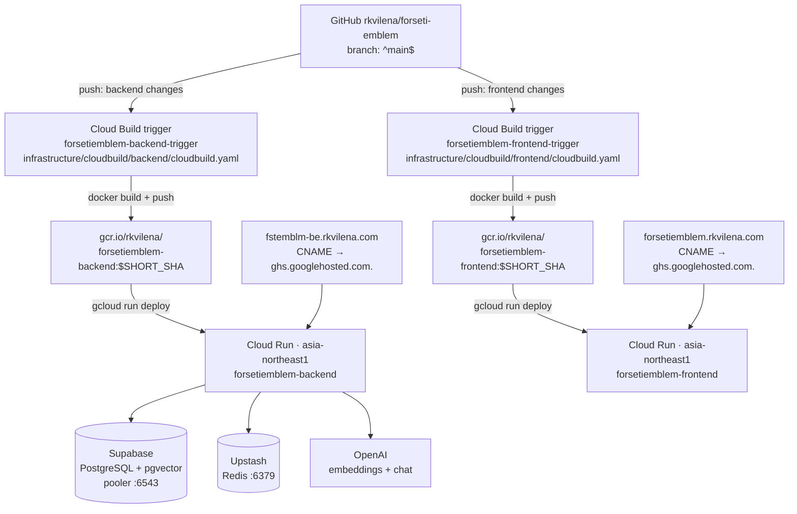
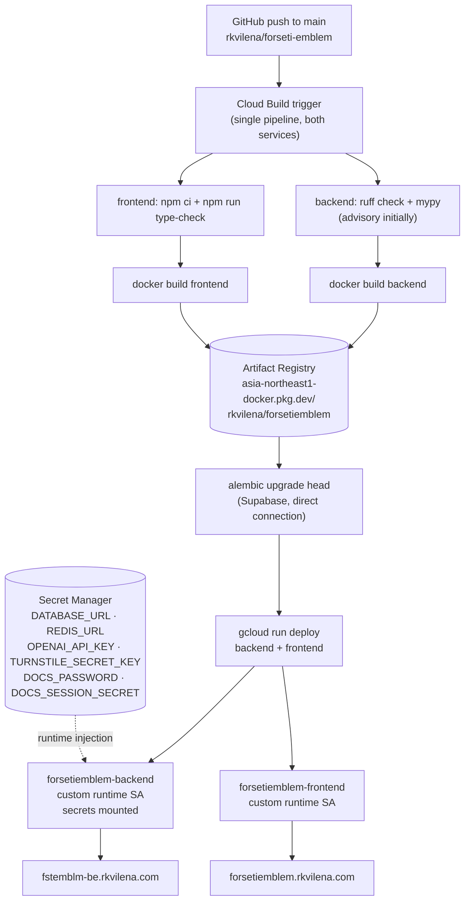

# Deployment Audit (Phase 1)

Read-only inventory of the live Google Cloud deployment as of 2026-10-30, taken with
`gcloud` against project `rkvilena` (account `rkvilena11@gmail.com`).

No infrastructure was modified to produce this document. **No secret values are
reproduced here** — only names and locations, so they can be rotated.

> **Update — Phase 2 (cleanup) completed.** Concretely:
>
> - The broken root `cloudbuild.yaml` and both per-service configs were **deleted**
>   (`S2-1`).
> - A single `infrastructure/cloudbuild/cloudbuild.yaml` now serves **both** services,
>   selected by `_TARGET` (validate → test → build → push → migrate → deploy) (`S2-4`).
> - Region is now defined once, as `asia-northeast1` (`S2-2`).
> - Images build to **Artifact Registry**
>   `asia-northeast1-docker.pkg.dev/rkvilena/forsetiemblem/{backend,frontend}` (`S2-3`
>   resolved in the pipeline; live services keep their `gcr.io` images until the next
>   deploy).
> - The duplicate `frontend/Dockerfile` was removed; `infrastructure/cloudbuild/frontend/Dockerfile`
>   is canonical (`S2-5`).
> - CI now runs `ruff`, `mypy`, `pytest` (10 tests), `npm run type-check`, and `npm run lint`.
> - Added `.gcloudignore`; build uploads dropped to 2.8 MiB.
> - Local `.env` files replaced with `.env.example` templates (`S1-2` hygiene).
> - Both triggers were repointed to the new config with `_TARGET` set, and the pipeline was
>   validated with a no-op build (`_TARGET=none` → `SUCCESS`).
>
> Still outstanding: `S1-1` and `S1-3` (secrets and IAM — the highest priority), `S2-6`,
> `S3-1`, `S3-2`, `S3-3`. Sections below are retained as the record of the
> **pre-refactor** state.
>
> **Update — pipeline split.** The single shared pipeline was replaced by two configs,
> `infrastructure/cloudbuild/backend/cloudbuild.yaml` and
> `infrastructure/cloudbuild/frontend/cloudbuild.yaml`, each with its own trigger and
> `includedFiles`; `_TARGET` is gone. Reason: Cloud Build resolves `availableSecrets` once
> per build, so the frontend build failed in the (skipped) `migrate` step whenever
> `forsetiemblem-prod-migration-database-url` was unavailable. The frontend config now has
> no `availableSecrets` at all. The backend test step receives `DATABASE_URL` because
> `app.db` builds the SQLAlchemy engine at import time. The plaintext secret substitutions
> that remained on the backend trigger were deleted; those credentials still need rotation.
>
> **Update — backend typing gate (2026-10-30).** `mypy app` is now **blocking** in
> `validate-backend`, and that step installs `backend/requirements.txt` so third-party
> types are actually available (`ignore_missing_imports` would otherwise resolve most
> libraries to `Any` and make the check vacuous). Getting to zero errors:
> `Chapter`/`ChapterChunk` moved to SQLAlchemy 2.0 `DeclarativeBase` + `Mapped[...]`
> (no more `Column[str]` leaking into call sites), `prop-decorator` is disabled in the
> mypy config for the `@computed_field` + `@property` pattern, OpenAI
> chat messages are typed as `ChatCompletionMessageParam`, `redis.Redis` drops the
> generic parameter removed in redis-py 8, the docs-auth middlewares match Starlette's
> `_MiddlewareFactory` signature (`ASGIApp` + positional-or-keyword options), and
> `types-requests` is installed.

## 1. Current architecture



## 2. Live resource inventory

### Cloud Run services (region `asia-northeast1`)

| Service | Image | Last capability | Ingress | Max scale | CPU / Memory | Concurrency | Timeout |
| ------- | ----- | --------------- | ------- | --------- | ------------ | ----------- | ------- |
| `forsetiemblem-backend` | `gcr.io/rkvilena/forsetiemblem-backend:9068f7b` | gen1 | `all` | 20 | 1000m / 512Mi | 80 | 300s |
| `forsetiemblem-frontend` | `gcr.io/rkvilena/forsetiemblem-frontend:9068f7b` | gen1 | `all` | 20 | 1000m / 512Mi | 80 | 300s |

Both use `startup-cpu-boost=true`, a default startup probe on port 8080/TCP
(240s period/timeout, failureThreshold 1), and serve 100% of traffic on the latest
revision. Generation 9 (backend) / 9 (frontend); last deployed 2026-10-12.

Runtime service account for **both** services:
`787750797743-compute@developer.gserviceaccount.com` (the default Compute Engine SA).

### Custom domains (Cloud Run domain mappings)

| Domain | Route to service | DNS record |
| ------ | ---------------- | ---------- |
| `forsetiemblem.rkvilena.com` | `forsetiemblem-frontend` | CNAME `forsetiemblem` -> `ghs.googlehosted.com.` |
| `fstemblm-be.rkvilena.com` | `forsetiemblem-backend` | CNAME `fstemblm-be` -> `ghs.googlehosted.com.` |

Both mappings report `Ready`, `CertificateProvisioned`, and `DomainRoutable`.

The backend service is therefore publicly reachable at a stable custom API host, and the
frontend is built with `NEXT_PUBLIC_API_URL=https://fstemblm-be.rkvilena.com`. This is
already better than deriving the API URL from the generated `run.app` hostname.

### Cloud Build

Two **1st-gen** GitHub triggers, both on `^main$`, both running as the default Compute SA:

| Trigger | Repo | Config file | Included files |
| ------- | ---- | ----------- | -------------- |
| `forsetiemblem-backend-trigger` | `rkvilena/forseti-emblem` | `infrastructure/cloudbuild/backend/cloudbuild.yaml` | `backend/**`, `infrastructure/cloudbuild/backend/**` |
| `forsetiemblem-frontend-trigger` | `rkvilena/forseti-emblem` | `infrastructure/cloudbuild/frontend/cloudbuild.yaml` | `frontend/**`, `infrastructure/cloudbuild/frontend/**` |

### Image registry

- Images live in **Container Registry** (`gcr.io/rkvilena`).
- Artifact Registry has one repository: `cloud-run-source-deploy` (Docker, 0 MB — unused).
- `gcr.io/rkvilena` also holds images for a different project (`providence-tower`) and the
  `rkvilena-*` services, which belong to a **separate** GitHub repo (`rkvilena-mainsite`).

### Secret Manager

No secrets exist for this project. The only secrets in the project
(`ngotbot-openai-key`, `providence-openai-api-key`) belong to other applications.

### Enabled APIs (relevant)

`run`, `cloudbuild`, `artifactregistry`, `secretmanager`, `compute`, `sql-component`.
`redis.googleapis.com` and `dns.googleapis.com` are **not** enabled (not needed: Redis is
Upstash and DNS is managed externally).

### Tooling

`gcloud` 588.0.0 is authenticated. **Terraform and OpenTofu are not installed** on this
machine, and the `beta` gcloud component cannot be installed (no write access to the SDK
directory), so `gcloud beta run domain-mappings` is unavailable — domain mappings were read
through the Cloud Run API instead.

## 3. Findings

Ordered by severity. `S1` = must fix before any Terraform work; `S2` = fix during the
refactor; `S3` = cleanup/quality.

### S1-1 — Production secrets are stored in plaintext

Runtime configuration is injected as **plain environment variables** on the Cloud Run
services, and the same values are stored again as **Cloud Build trigger substitutions** and
as committed files under `infrastructure/cloudbuild/*/.env`.

Affected values (names only, values intentionally not recorded):

| Variable | Where it is exposed |
| -------- | ------------------- |
| `OPENAI_API_KEY` | Cloud Run env, trigger substitutions, `infrastructure/cloudbuild/backend/.env` |
| `DATABASE_URL` (contains Supabase password) | Cloud Run env, trigger substitutions, `.env` |
| `REDIS_URL` (contains Upstash token) | Cloud Run env, trigger substitutions, `.env` |
| `TURNSTILE_SECRET_KEY` | Cloud Run env, trigger substitutions, `.env` |
| `DOCS_PASSWORD` | Cloud Run env, trigger substitutions, `.env` |
| `DOCS_SESSION_SECRET` | Cloud Run env, trigger substitutions, `.env` |

Impact: anyone with read access to the project, Cloud Build history, or the repository can
recover live credentials. Cloud Build substitutions are also visible in build metadata.

**Required action: rotate every one of these credentials** (OpenAI key, Supabase database
password, Upstash token, Turnstile secret, docs password, docs session secret) and migrate
them to Secret Manager. Rotation must happen even after the values are removed from the repo,
because they have already been stored in multiple systems.

> `DOCS_USERNAME` and `NEXT_PUBLIC_*` values are not secrets, but a docs username paired with
> a plaintext password still warrants rotation.

### S1-2 — Secret-bearing `.env` files exist on disk and are **not** committed

`infrastructure/cloudbuild/backend/.env` and `infrastructure/cloudbuild/frontend/.env` exist
locally and mirror the production configuration. Verified:

```bash
git log --all -- 'infrastructure/cloudbuild/backend/.env'   # no commits
git ls-files | grep '\.env'                                 # only *.env.example tracked
```

`.gitignore` already contains `**/.env`, so these files have **never been committed**. This
is therefore a hygiene issue, not a leak.

**Required action (lower priority than S1-1):** keep local `.env` files out of any tooling
that uploads context (Docker build context, Cloud Build source archives, `build.sh`
invocations), and replace them with `*.env.example` templates listing variable names only.

### S1-3 — Everything runs as the default Compute service account

Both Cloud Run services **and** both Cloud Build triggers run as
`787750797743-compute@developer.gserviceaccount.com`, which holds:

```text
roles/editor
roles/run.admin
roles/artifactregistry.writer
roles/iam.serviceAccountUser
roles/logging.logWriter
```

Problems:

- `roles/editor` on a publicly reachable backend container is a serious blast-radius issue.
- Build and runtime share one identity, so the running application can deploy itself.
- `roles/iam.serviceAccountUser` combined with `roles/editor` permits SA impersonation.

**Required action:** dedicated least-privilege identities:

```text
forsetiemblem-backend-runtime   -> Secret Manager accessor (+ logging)
forsetiemblem-frontend-runtime  -> no project roles (+ logging)
forsetiemblem-cloudbuild        -> run.admin, artifactregistry.writer,
                                   iam.serviceAccountUser (scoped to runtime SAs),
                                   logging.logWriter
```

### S2-1 — The root `cloudbuild.yaml` is broken and unreferenced

`/cloudbuild.yaml` builds `backend/Dockerfile`, which **does not exist** (the real production
backend Dockerfile is `infrastructure/cloudbuild/backend/Dockerfile`). It also targets
`us-central1` and unused Artifact Registry paths, passes no runtime configuration, and no
trigger references it. It should be deleted.

### S2-2 — Region is inconsistent across configurations

| File | Region |
| ---- | ------ |
| Root `cloudbuild.yaml` | `us-central1` |
| `infrastructure/cloudbuild/backend/cloudbuild.yaml` | `asia-northeast1` |
| `infrastructure/cloudbuild/frontend/cloudbuild.yaml` | `asia-northeast1` |
| Live Cloud Run services | `asia-northeast1` |

Live deployment is `asia-northeast1`, which also matches Supabase (`ap-northeast-1`) and
Upstash. The `us-central1` values are stale and must go.

### S2-3 — Registry is inconsistent

Live images are in `gcr.io` (Container Registry, legacy), while the root config and the
enabled `artifactregistry.googleapis.com` point at Artifact Registry. The only Artifact
Registry repository (`cloud-run-source-deploy`) is empty and unused.

**Required action:** converge on a single Artifact Registry repository, e.g.
`asia-northeast1-docker.pkg.dev/rkvilena/forsetiemblem/{backend,frontend}`, and redeploy from
there. This changes live image references, so it must be deliberate.

### S2-4 — Duplicated pipelines with no shared contract and no CI checks

Backend and frontend each have a copy-pasted build/push/deploy pipeline that independently
re-declares region, names, and environment. There is **no test or type-check stage at all**,
so nothing is validated before a `main` push reaches production.

### S2-5 — Two divergent production frontend Dockerfiles

`frontend/Dockerfile` accepts only `NEXT_PUBLIC_API_URL`, while
`infrastructure/cloudbuild/frontend/Dockerfile` also accepts
`NEXT_PUBLIC_TURNSTILE_SITE_KEY` and `NEXT_PUBLIC_CHAT_STORAGE_KEY`. Only the latter is used
in production. This should collapse to one canonical Dockerfile.

### S2-6 — No image retention or release alias

Images are tagged `:$SHORT_SHA` (good for immutability) but there is no alias tag and no
cleanup policy, so the registry grows unbounded.

### S3-1 — Domain mappings are outside infrastructure-as-code

`forsetiemblem.rkvilena.com` and `fstemblm-be.rkvilena.com` are live Cloud Run domain
mappings unknown to Terraform. They must be **imported** so certificate provisioning and DNS
are not disturbed.

### S3-2 — Several applications share one GCP project

| Application | Cloud Run services | GitHub repo |
| ----------- | ------------------ | ----------- |
| Forsetiemblem | `forsetiemblem-backend`, `forsetiemblem-frontend` | `forseti-emblem` |
| Main site | `rkvilena-frontend`, `rkvilena-backend` | `rkvilena-mainsite` |
| Other images | — | `providence-tower` (images only) |

Terraform must be **scoped by resource name** and must never run project-wide destructive
operations. Shared project-level settings (API enablement) need explicit care.

### S3-3 — Local Compose setup is broken

`infrastructure/compose/local.dev.yml` references the missing `backend/Dockerfile.dev` and
defines no Redis service. Unrelated to cloud deployment, but part of the same cleanup.

### S3-4 — Terraform/OpenTofu is not installed

Neither binary is available locally; installation is a Phase 3 prerequisite.

## 4. Target architecture

Single environment, single region, no staging/promotion layer (Cloud Deploy is
intentionally **not** used).



### Responsibility split

| Concern | Owner |
| ------- | ----- |
| Cloud Run services, service accounts, IAM | Terraform |
| Artifact Registry repository | Terraform |
| Secret Manager secret containers + IAM | Terraform |
| Cloud Build triggers | Terraform |
| Domain mappings | Terraform (imported, not recreated) |
| Image build + push | Cloud Build |
| Database migration | Cloud Build (explicit step) |
| Deployed image revision | Cloud Build |
| Secret *values* | Manual / out-of-band, never Terraform |
| Supabase PostgreSQL | Supabase (external) |
| Upstash Redis | Upstash (external) |
| DNS zone records | Existing DNS provider (CNAMEs already set) |

Terraform must **not** own the `image` field of the Cloud Run container, otherwise every
`gcloud run deploy` from CI would create permanent state drift. The image is managed by CI.

### Planned repository layout

```text
infrastructure/
├── README.md
├── audit/                     # this document
├── compose/
│   └── local.dev.yml
├── cloudbuild/
│   └── cloudbuild.yaml        # single pipeline for both services
└── terraform/
    ├── bootstrap/             # creates the GCS state bucket (run once)
    └── production/
        ├── backend.tf
        ├── providers.tf
        ├── variables.tf
        ├── artifact-registry.tf
        ├── service-accounts.tf
        ├── secrets.tf
        ├── cloud-run.tf
        ├── cloud-build.tf
        └── import-steps.md
```

## 5. Migration plan

### Phase 2 — Cleanup (no infrastructure change yet)

1. Delete `/cloudbuild.yaml` (broken, unreferenced).
2. Replace local `infrastructure/cloudbuild/backend/.env` and `.../frontend/.env` with
   `*.env.example` templates containing variable names, comments, and no values.
3. Keep the existing `**/.env` rules in both `.gitignore` and `.dockerignore` (both already
   present) so local `.env` files never reach git or a build context.
4. Collapse the two pipelines into one `infrastructure/cloudbuild/cloudbuild.yaml`.
5. Converge on `asia-northeast1` and one Artifact Registry repository.
6. Collapse to one canonical frontend Dockerfile.
7. Add a validation stage (frontend `type-check`, backend `ruff check`).
8. Add an explicit `alembic upgrade head` deployment step.
9. Update triggers to point at the new single config file.

The infrastructure itself is unchanged in this phase: services, domains, and traffic stay
exactly as they are.

### Phase 3 — Terraform adoption

1. Install Terraform (or OpenTofu) locally.
2. Create the GCS state bucket (bootstrap, versioned, restricted).
3. Write configuration describing the **current** reality precisely.
4. `terraform import` the existing resources:

```bash
terraform import google_cloud_run_v2_service.backend \
  projects/rkvilena/locations/asia-northeast1/services/forsetiemblem-backend
```

5. Run `terraform plan` until it reports **no changes** (or only intentional ones).
6. Only then apply anything new (Secret Manager containers, service accounts, IAM).
7. Import the two domain mappings.
8. Migrate triggers to Terraform-managed definitions.

Success criterion for Phase 3: `terraform plan` produces no unexpected diff on an
already-deployed system.

### Phase 4 — Secret rotation and cutover

1. Rotate all six exposed credentials at their source.
2. Store new values in Secret Manager.
3. Switch Cloud Run to `--set-secrets` references (via Terraform).
4. Remove secrets from triggers and from Cloud Run plaintext env vars.
5. Verify `/health`, chat, ingestion, and both custom domains.
6. Revoke the old credentials.

### Phase 5 — Verification and documentation

1. Deploy a trivial change end-to-end through the new pipeline.
2. Confirm `terraform plan` is clean afterwards (no drift).
3. Document rollback via Cloud Run revisions:

```bash
gcloud run services update-traffic forsetiemblem-backend \
  --region=asia-northeast1 \
  --to-revisions=<previous-revision>=100
```

4. Update `README.md`, `documentation/backend.md`, and add `infrastructure/README.md`.

## 6. Decisions locked in

| Decision | Value |
| -------- | ----- |
| GCP project | `rkvilena` |
| Region | `asia-northeast1` |
| Services | Existing `forsetiemblem-backend`, `forsetiemblem-frontend` (imported) |
| Custom domains | Preserved: `forsetiemblem.rkvilena.com`, `fstemblm-be.rkvilena.com` |
| Database | Supabase (external, not Terraform-managed) |
| Redis | Upstash (external, not Terraform-managed) |
| CI/CD | Cloud Build only, direct to Cloud Run |
| Release manager | None (no Cloud Deploy) |
| Deploy trigger | Push to `main` |
| Terraform scope | Standard: registry, services, SAs, IAM, secrets, triggers, domains |
| Terraform state | GCS remote backend |
| Secrets | Secret Manager; containers in Terraform, values out-of-band |
| Migrations | Explicit `alembic upgrade head` in CI |

## 7. Open risks

1. **Credential exposure is live now.** Rotation is the highest-priority action and is not
   blocked by any refactor work.
2. **Shared GCP project.** `rkvilena-mainsite` and `providence-tower` resources must never be
   touched; every Terraform resource needs explicit naming and no project-wide deletes.
3. **Domain mappings.** Any accidental recreate risks a temporary certificate/DNS outage.
4. **Supabase pooler + Alembic.** The live `DATABASE_URL` uses the transaction-mode pooler
   (port `6543`), which is generally unsuitable for migrations; Alembic should use the direct
   or session-mode connection (port `5432`).
5. **Trigger migration gap.** Replacing 1st-gen triggers with Terraform-managed triggers can
   briefly leave the repo without a working build; do it during a quiet window.


