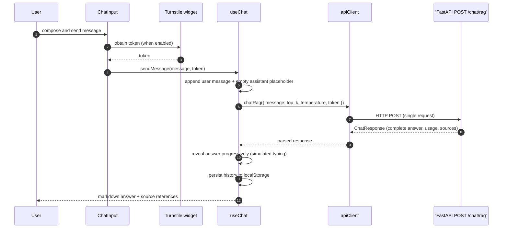

# Frontend Documentation

The frontend is a Next.js 15 app that provides the Fire Emblem chat experience and supporting pages. It integrates Cloudflare Turnstile for human verification and calls the backend RAG API.

This document covers how the frontend works: architecture, routing, the chat lifecycle, API integration, and UI design decisions.

> **Looking to install or run the frontend?** See [frontend/README.md](../frontend/README.md) for setup, commands, environment variables, and troubleshooting.

## Contents

1. [Architecture Overview](#architecture-overview)
2. [Pages and Routing](#pages-and-routing)
3. [Chat Flow](#chat-flow)
4. [Turnstile Integration](#turnstile-integration)
5. [API Usage](#api-usage)
6. [UI Structure and Behavior](#ui-structure-and-behavior)
7. [Theme](#theme)
8. [Design Notes and Known Gaps](#design-notes-and-known-gaps)

## Architecture Overview

| Directory | Purpose |
| --------- | ------- |
| `frontend/src/app/` | Next.js App Router pages |
| `frontend/src/components/chat/` | Chat UI components (container, input, messages, sidebar) |
| `frontend/src/hooks/` | `use-chat`, `use-theme`, `use-text-size`, `use-auto-scroll`, `use-local-storage` |
| `frontend/src/lib/` | `api-client.ts` (backend calls) and utilities |
| `frontend/src/styles/` | Global styles, theme, markdown styles |
| `frontend/src/types/` | TypeScript types mirroring backend Pydantic schemas |

## Pages and Routing

Pages live in `frontend/src/app` using the App Router.

| Route | File | Purpose |
| ----- | ---- | ------- |
| `/` | `frontend/src/app/page.tsx` | Chat UI and RAG conversation flow |
| `/chapters` | `frontend/src/app/chapters/page.tsx` | Lists ingested chapters grouped by game |
| `/about` | `frontend/src/app/about/page.tsx` | About the project |
| `/disclaimer` | `frontend/src/app/disclaimer/page.tsx` | Legal and safety disclaimer |
| `/settings` | `frontend/src/app/settings/page.tsx` | UI settings and user preferences |

## Chat Flow

1. User composes a message in `ChatInput`.
2. Turnstile provides a token (required when Turnstile is enabled in the backend).
3. `useChat` adds the user message and an assistant placeholder.
4. `apiClient` calls `POST /chat/rag` with `message`, `top_k`, `temperature`, and `token`.
5. The response is revealed progressively in the placeholder for a typing effect.
6. Messages are persisted in localStorage for session restoration.

> **Note on "streaming":** the backend returns the **complete** response in a single HTTP response. The frontend then progressively reveals that already-complete text on a timer to create a typing effect. There is no server-sent streaming.

Key modules:

- `frontend/src/hooks/use-chat.ts` — message state, persistence, retries, and the simulated streaming
- `frontend/src/lib/api-client.ts` — backend requests and error handling
- `frontend/src/components/chat/` — message list, input, and sidebar UI

Persistence details:

- Chat history is stored in localStorage under the hardcoded key `forsetiemblem_chat_history_v1`.
- `NEXT_PUBLIC_CHAT_STORAGE_KEY` in `.env.example` is **currently unused** — changing it will not change the storage key. Clearing the chat (sidebar) removes the stored history.

## Turnstile Integration

- The Turnstile script loads in the root layout (`frontend/src/app/layout.tsx`).
- `ChatInput` renders a Turnstile widget using `NEXT_PUBLIC_TURNSTILE_SITE_KEY`.
- The token is required to send messages when Turnstile is enabled in the backend.
- Tokens are reset after a successful send.

Relevant files:

- `frontend/src/components/chat/chat-input.tsx`
- `frontend/src/types/turnstile.d.ts`

## API Usage

The base URL is `NEXT_PUBLIC_API_URL`, defaulting to `http://localhost:8000`.

| Method | Path | Usage in frontend |
| ------ | ---- | ----------------- |
| GET | `/health` | Health checks via `apiClient.health()` |
| POST | `/chat/rag` | Main chat API via `apiClient.chatRag()` |
| GET | `/chapters` | Chapters list via `apiClient.listChapters()` |

Request/response shapes are defined in:

- `frontend/src/types/api.ts` — API responses
- `frontend/src/types/chat.ts` — chat message shapes and RAG request types

Errors are surfaced as `ApiClientError` (from `frontend/src/lib/api-client.ts`); on error, the assistant placeholder is replaced with an error message in the chat.

## UI Structure and Behavior

- The sidebar provides navigation and utility controls (theme, text size, clear chat).
- `ChatContainer` renders the conversation and auto-scrolls (`use-auto-scroll.ts`).
- `ChatMessage` supports markdown rendering for assistant responses.
- Themes and text size are user-configurable and persisted client-side.

Key files:

- `frontend/src/components/chat/sidebar.tsx`
- `frontend/src/components/chat/chat-container.tsx`
- `frontend/src/components/chat/chat-message.tsx`
- `frontend/src/hooks/use-theme.ts`
- `frontend/src/hooks/use-text-size.ts`
- `frontend/src/styles/globals.css`

## Theme

The design system uses a Fire Emblem-inspired color palette:

- **Primary**: Royal blue tones (Forseti's wind magic)
- **Accent**: Sacred gold (nobility and crests)
- **Crimson**: Action highlights
- **Surface**: Dark parchment-like backgrounds

All colors are centralized in `tailwind.config.ts` and `frontend/src/styles/theme.ts`.

## Design Notes and Known Gaps

- **No true server streaming**: the backend returns the complete response in one HTTP response; the "typing" effect is client-side simulation of already-complete text. If real streaming is desired, the backend would need SSE/WebSocket support and `api-client.ts` would consume it.
- **Unused env var**: `NEXT_PUBLIC_CHAT_STORAGE_KEY` is defined in `.env.example`, but `use-chat.ts` hardcodes `forsetiemblem_chat_history_v1`. Either wire the variable into the hook or remove it from `.env.example`.
- **Types mirror the backend manually**: `frontend/src/types/api.ts` and `chat.ts` duplicate the backend Pydantic schemas; changes on the backend must be updated here by hand.
- Environment variables and their values are listed in [frontend/README.md](../frontend/README.md#environment-variables).
