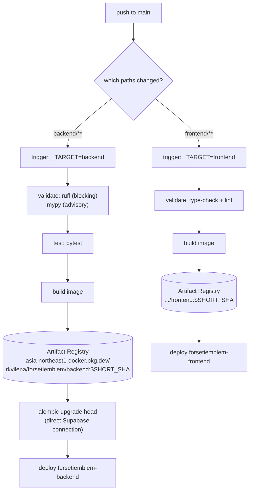

# Infrastructure

Everything related to building, shipping, and hosting Forsetiemblem.

- **CI/CD**: Google Cloud Build → Artifact Registry → Cloud Run (single environment)
- **Region**: `asia-northeast1` (GCP project `rkvilena`)
- **Postgres**: Supabase (external, not managed here)
- **Redis**: Upstash (external, not managed here)

> Historical context, findings, and the remaining refactor phases live in
> [`documentation/deployment-audit.md`](../documentation/deployment-audit.md).

## Layout

```text
infrastructure/
├── cloudbuild/
│   ├── cloudbuild.yaml          # the only deployment pipeline
│   ├── build.sh                 # build + smoke-test an image locally
│   ├── backend/
│   │   ├── Dockerfile           # production backend image
│   │   └── .env.example         # local template (real .env is gitignored)
│   └── frontend/
│       ├── Dockerfile           # production frontend image
│       └── .env.example         # local template (real .env is gitignored)
└── compose/
    ├── local.dev.yml            # local Postgres (api/web services are unused)
    └── vm.db.yml                # standalone Postgres/pgvector for a VM
```

## Deployment pipeline

There is **one** pipeline, `cloudbuild/cloudbuild.yaml`, shared by both services.
The trigger picks the service through the `_TARGET` substitution.



Steps that do not apply to the selected target exit immediately, so a backend build
skips the frontend stages and vice versa.

### Triggers

| Trigger | Paths that fire it | `_TARGET` |
| ------- | ------------------ | --------- |
| `forsetiemblem-backend-trigger` | `backend/**`, `infrastructure/cloudbuild/cloudbuild.yaml` | `backend` |
| `forsetiemblem-frontend-trigger` | `frontend/**`, `infrastructure/cloudbuild/cloudbuild.yaml` | `frontend` |

Both are 1st-gen GitHub triggers on `^main$` for `rkvilena/forseti-emblem`.
Editing `cloudbuild.yaml` itself fires both.

> **Note:** `gcloud builds triggers update github` rejects these triggers with
> `INVALID_ARGUMENT`, and a partial `PATCH` is rejected too. Send the **full trigger
> resource** back with `PATCH /v1/projects/rkvilena/triggers/{id}` when you need to
> change one.

## Configuration

Non-secret runtime configuration is supplied through Cloud Build substitutions, which the
triggers override. Defaults live at the top of `cloudbuild.yaml`.

| Substitution | Target | Notes |
| ------------ | ------ | ----- |
| `_TARGET` | both | `backend` or `frontend`; set by the trigger |
| `_REGION` / `_AR_REPO` | both | `asia-northeast1` / `forsetiemblem` |
| `_BACKEND_SERVICE` / `_FRONTEND_SERVICE` | both | Cloud Run service names |
| `_NEXT_PUBLIC_API_URL` | frontend | Build-time; `https://fstemblm-be.rkvilena.com` |
| `_NEXT_PUBLIC_TURNSTILE_SITE_KEY` | frontend | Build-time, public |
| `_NEXT_PUBLIC_CHAT_STORAGE_KEY` | frontend | Build-time, public |
| `_ENVIRONMENT`, `_CORS_ALLOWED_ORIGIN` | backend | Public |
| `_OPENAI_*`, `_RATE_LIMIT_*`, `_DOCS_*`, `_TURNSTILE_*` | backend | Public (no values) |
| `_SECRET_*` | backend | Secret Manager **IDs** only, never values |
| `_RUNTIME_SERVICE_ACCOUNT` | backend | Empty = keep current identity |
| `_RUN_MIGRATIONS` | backend | `"true"` (default) or `"false"` to skip Alembic |

### Secrets (Secret Manager)

Project `rkvilena` hosts several applications, so every secret ID is prefixed
`<app>-<env>-`. Values live only in Secret Manager; the container still sees the plain
variable names.

| Runtime variable | Secret Manager ID |
| ---------------- | ----------------- |
| `DATABASE_URL` | `forsetiemblem-prod-database-url` |
| `MIGRATION_DATABASE_URL` | `forsetiemblem-prod-migration-database-url` |
| `OPENAI_API_KEY` | `forsetiemblem-prod-openai-api-key` |
| `REDIS_URL` | `forsetiemblem-prod-redis-url` |
| `TURNSTILE_SECRET_KEY` | `forsetiemblem-prod-turnstile-secret-key` |
| `DOCS_PASSWORD` | `forsetiemblem-prod-docs-password` |
| `DOCS_SESSION_SECRET` | `forsetiemblem-prod-docs-session-secret` |

Wiring:

- **Cloud Run** reads `DATABASE_URL`, `OPENAI_API_KEY`, `REDIS_URL`,
  `TURNSTILE_SECRET_KEY`, `DOCS_PASSWORD`, `DOCS_SESSION_SECRET` via `--set-secrets`.
- **Cloud Build** receives only `MIGRATION_DATABASE_URL`, via `availableSecrets` +
  `secretEnv`, and only in the `migrate` step.

Create a secret (value is read from stdin, so it stays out of shell history):

```bash
read -rs VALUE
printf '%s' "$VALUE" | gcloud secrets versions add forsetiemblem-prod-redis-url --data-file=-
unset VALUE
```

> **Required before any build.** `availableSecrets` is resolved for *every* build,
> including the `_TARGET=none` validation build and the frontend trigger. If
> `forsetiemblem-prod-migration-database-url` does not exist, the build fails with
> `PermissionDenied: secretmanager.versions.access`. Use `_RUN_MIGRATIONS=false` to skip
> the migration *step*, not the secret lookup.

### Migrations

The `migrate` step runs Alembic inside the freshly built backend image, using the
`MIGRATION_DATABASE_URL` value pulled from
`forsetiemblem-prod-migration-database-url`. Set `_RUN_MIGRATIONS=false` to skip it for a
single build. The backend image has no `ENTRYPOINT`, so the explicit `alembic` command
replaces the server command and the app never starts during migration. Two reasons the
step exists separately from startup:

1. Supabase's transaction pooler (port `6543`) is unreliable for DDL; migrations need the
   direct connection (port `5432`).
2. Migrations should fail the build before a bad image is deployed.

`backend/entrypoint.sh` still runs `alembic upgrade head` at container start (against the
pooled URL). Now that migrations run in CI, that startup migration is redundant and can be
removed.

## Deploying

Normal deploys happen automatically on push to `main`.

Manual run of the pipeline (no push):

```bash
# Validate the config without building or deploying anything.
# Still resolves availableSecrets, so the migration secret must exist.
gcloud builds submit --config=infrastructure/cloudbuild/cloudbuild.yaml \
  --substitutions=_TARGET=none --region=asia-northeast1 .

# Real backend deploy from your machine -- no secret values on the command line
gcloud builds submit --config=infrastructure/cloudbuild/cloudbuild.yaml \
  --substitutions=_TARGET=backend --region=asia-northeast1 .
```

Building and smoke-testing an image locally:

```bash
bash infrastructure/cloudbuild/build.sh \
  infrastructure/cloudbuild/backend/Dockerfile 8080 infrastructure/cloudbuild/backend/.env

bash infrastructure/cloudbuild/build.sh \
  infrastructure/cloudbuild/frontend/Dockerfile 3000 infrastructure/cloudbuild/frontend/.env
```

## Rollback

Cloud Run keeps every revision. To roll back, shift traffic to a previous revision:

```bash
gcloud run revisions list --service=forsetiemblem-backend --region=asia-northeast1

gcloud run services update-traffic forsetiemblem-backend \
  --region=asia-northeast1 \
  --to-revisions=forsetiemblem-backend-00009-85f=100
```

Images are tagged with the commit SHA, so a rollback can also be done by re-deploying the
previous tag from Artifact Registry.

## Custom domains

Cloud Run domain mappings (already provisioned, do not recreate):

| Domain | Service |
| ------ | ------- |
| `forsetiemblem.rkvilena.com` | `forsetiemblem-frontend` |
| `fstemblm-be.rkvilena.com` | `forsetiemblem-backend` |

Both use a CNAME to `ghs.googlehosted.com.`

## Local development

See the root [`README.md`](../README.md). The Compose file's `api`/`web` services are
broken (they reference a missing `backend/Dockerfile.dev`), so the supported local path is
running backend and frontend natively with Docker only for Postgres and Redis.

## Known gaps

1. **Old secret values are still exposed** in the existing Cloud Run revisions and in the
   backend trigger's leftover substitutions. They must be rotated, then removed from the
   trigger. Values in Secret Manager are new and never appear in build metadata.
2. **Everything runs as the default Compute service account** (`roles/editor`), which can
   read every secret in the project, not just this app's. Planned fix: dedicated
   `forsetiemblem-runtime` / `forsetiemblem-cloud-build` identities, wired through
   `_RUNTIME_SERVICE_ACCOUNT`.
3. **No Terraform yet.** Infrastructure is still created by hand; adoption is the next
   phase.
4. **`docs_auth` session secret and docs password are weak/plaintext** and need rotation.
5. **`mypy` is advisory in CI.** There are 18 pre-existing type errors in 8 files
   (mostly `Column[str]` vs `str` and Starlette middleware signatures). Fix them, then drop
   the `|| echo` in the validate step to make the stage blocking.
6. **`backend/entrypoint.sh` still migrates on startup** using the pooled URL, in addition
   to the (currently skipped) CI migration step.

