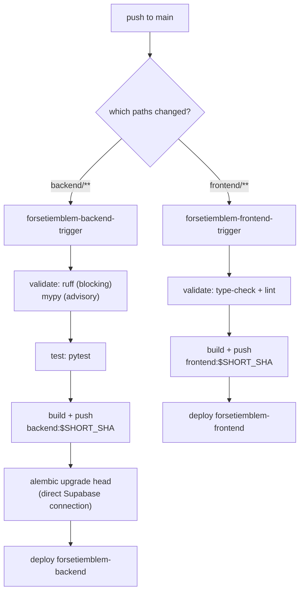

# Infrastructure

Everything related to building, shipping, and hosting Forsetiemblem.

- **CI/CD**: Google Cloud Build → Artifact Registry → Cloud Run (single environment)
- **Region**: `asia-northeast1` (GCP project `rkvilena`)
- **Postgres**: Supabase (external, not managed here)
- **Redis**: Upstash (external, not managed here)

> Historical context, findings, and the remaining refactor phases live in
> [`documentation/deployment-audit.md`](../documentation/deployment-audit.md).

## Layout

```text
infrastructure/
├── cloudbuild/
│   ├── build.sh                 # build + smoke-test an image locally
│   ├── backend/
│   │   ├── cloudbuild.yaml      # backend pipeline (validate → test → build → migrate → deploy)
│   │   ├── Dockerfile           # production backend image
│   │   └── .env.example         # local template (real .env is gitignored)
│   └── frontend/
│       ├── cloudbuild.yaml      # frontend pipeline (validate → build → deploy)
│       ├── Dockerfile           # production frontend image
│       └── .env.example         # local template (real .env is gitignored)
└── compose/
    ├── local.dev.yml            # local Postgres (api/web services are unused)
    └── vm.db.yml                # standalone Postgres/pgvector for a VM
```

## Deployment pipeline

There are **two** independent pipelines, one per Cloud Run service. Neither pipeline
contains the other service's steps, so a frontend build cannot fail because of a backend
secret, a migration, or a database problem (and vice versa).

| Pipeline | Config file | Steps |
| -------- | ----------- | ----- |
| Backend | `cloudbuild/backend/cloudbuild.yaml` | validate (ruff/mypy) → test (pytest) → build + push → Alembic → deploy |
| Frontend | `cloudbuild/frontend/cloudbuild.yaml` | validate (type-check/lint) → build + push → deploy |



### Triggers

| Trigger | Paths that fire it | Config file |
| ------- | ------------------ | ----------- |
| `forsetiemblem-backend-trigger` | `backend/**`, `infrastructure/cloudbuild/backend/**` | `infrastructure/cloudbuild/backend/cloudbuild.yaml` |
| `forsetiemblem-frontend-trigger` | `frontend/**`, `infrastructure/cloudbuild/frontend/**` | `infrastructure/cloudbuild/frontend/cloudbuild.yaml` |

Both are 1st-gen GitHub triggers on `^main$` for `rkvilena/forseti-emblem`. There is no
`_TARGET` substitution any more: each config is dedicated to one service, so a shared
pipeline cannot make one service depend on the other's secrets.

### Repointing a trigger

`gcloud builds triggers update github` rejects these triggers with `INVALID_ARGUMENT`, and a
partial `PATCH` is rejected too. Export the **full trigger resource**, edit it, then `PATCH`
it back:

```bash
export PROJECT=rkvilena
TOKEN="$(gcloud auth print-access-token)"

gcloud builds triggers describe forsetiemblem-backend-trigger \
  --project="$PROJECT" --format=json > backend-trigger.json
python - <<'PY'
import json
path = "backend-trigger.json"
doc = json.load(open(path))
doc["filename"] = "infrastructure/cloudbuild/backend/cloudbuild.yaml"
doc["includedFiles"] = ["backend/**", "infrastructure/cloudbuild/backend/**"]
subs = doc.get("substitutions") or {}
# Drop the obsolete _TARGET and the plaintext secrets from the pre-Secret-Manager setup.
for key in ("_TARGET", "_DATABASE_URL", "_OPENAI_API_KEY", "_REDIS_URL",
            "_TURNSTILE_SECRET_KEY", "_DOCS_PASSWORD", "_DOCS_SESSION_SECRET"):
    subs.pop(key, None)
doc["substitutions"] = subs
json.dump(doc, open(path, "w"))
PY
curl -sS -X PATCH -H "Authorization: Bearer $TOKEN" -H "Content-Type: application/json" \
  --data @backend-trigger.json \
  "https://cloudbuild.googleapis.com/v1/projects/$PROJECT/triggers/c4423915-1f51-4148-9755-090c28175bbc"

gcloud builds triggers describe forsetiemblem-frontend-trigger \
  --project="$PROJECT" --format=json > frontend-trigger.json
python - <<'PY'
import json
path = "frontend-trigger.json"
doc = json.load(open(path))
doc["filename"] = "infrastructure/cloudbuild/frontend/cloudbuild.yaml"
doc["includedFiles"] = ["frontend/**", "infrastructure/cloudbuild/frontend/**"]
doc["substitutions"] = {
    k: v for k, v in (doc.get("substitutions") or {}).items() if k != "_TARGET"
}
json.dump(doc, open(path, "w"))
PY
curl -sS -X PATCH -H "Authorization: Bearer $TOKEN" -H "Content-Type: application/json" \
  --data @frontend-trigger.json \
  "https://cloudbuild.googleapis.com/v1/projects/$PROJECT/triggers/614beb7b-fc81-4a1c-9aee-ba686ed28f4c"

rm -f backend-trigger.json frontend-trigger.json
```

Both `PATCH` calls answer `HTTP 200`. `gcloud builds triggers list` can serve a stale
`filename` for a few seconds — confirm with `gcloud builds triggers describe`.

**Applied on 2026-10-30:** both triggers now point at the split configs, and the backend
trigger no longer stores any plaintext secret. Those credentials were readable in trigger
metadata for months, so **rotate them** (`DATABASE_URL`, `OPENAI_API_KEY`, `REDIS_URL`,
`TURNSTILE_SECRET_KEY`, `DOCS_PASSWORD`, `DOCS_SESSION_SECRET`).

## Configuration

Non-secret runtime configuration is supplied through Cloud Build substitutions, which the
triggers override. Defaults live at the top of each pipeline file.

| Substitution | Pipeline | Notes |
| ------------ | -------- | ----- |
| `_REGION` / `_AR_REPO` | both | `asia-northeast1` / `forsetiemblem` |
| `_BACKEND_SERVICE` | backend | Cloud Run service name |
| `_FRONTEND_SERVICE` | frontend | Cloud Run service name |
| `_NEXT_PUBLIC_API_URL` | frontend | Build-time; `https://fstemblm-be.rkvilena.com` |
| `_NEXT_PUBLIC_TURNSTILE_SITE_KEY` | frontend | Build-time, public |
| `_NEXT_PUBLIC_CHAT_STORAGE_KEY` | frontend | Build-time, public |
| `_ENVIRONMENT`, `_CORS_ALLOWED_ORIGIN` | backend | Public |
| `_OPENAI_*`, `_RATE_LIMIT_*`, `_DOCS_*`, `_TURNSTILE_*` | backend | Public (no values) |
| `_SECRET_*` | backend | Secret Manager **IDs** only, never values |
| `_RUNTIME_SERVICE_ACCOUNT` | backend | Empty = keep current identity |
| `_RUN_MIGRATIONS` | backend | `"true"` (default) or `"false"` to skip Alembic |

### Secrets (Secret Manager)

Project `rkvilena` hosts several applications, so every secret ID is prefixed
`<app>-<env>-`. Values live only in Secret Manager; the container still sees the plain
variable names.

| Runtime variable | Secret Manager ID |
| ---------------- | ----------------- |
| `DATABASE_URL` | `forsetiemblem-prod-database-url` |
| `MIGRATION_DATABASE_URL` | `forsetiemblem-prod-migration-database-url` |
| `OPENAI_API_KEY` | `forsetiemblem-prod-openai-api-key` |
| `REDIS_URL` | `forsetiemblem-prod-redis-url` |
| `TURNSTILE_SECRET_KEY` | `forsetiemblem-prod-turnstile-secret-key` |
| `DOCS_PASSWORD` | `forsetiemblem-prod-docs-password` |
| `DOCS_SESSION_SECRET` | `forsetiemblem-prod-docs-session-secret` |

Wiring:

- **Cloud Run** reads `DATABASE_URL`, `OPENAI_API_KEY`, `REDIS_URL`,
  `TURNSTILE_SECRET_KEY`, `DOCS_PASSWORD`, `DOCS_SESSION_SECRET` via `--set-secrets`.
- **Backend pipeline** receives `DATABASE_URL` in the `test-backend` step and
  `MIGRATION_DATABASE_URL` in the `migrate` step, via `availableSecrets` + `secretEnv`.
- **Frontend pipeline** receives no secrets at all: its config has no `availableSecrets`
  block, so a frontend build can never be blocked by secret IAM or a missing database URL.

`pytest` imports `app.main`, and `app.db` builds the SQLAlchemy engine at import time, so
`DATABASE_URL` must be present and parseable. The engine is lazy and the unit tests never
issue a query, so no connection is opened against the database. If a database-backed test
is added later, point that step at a dedicated CI secret instead of the production URL.

Create a secret (value is read from stdin, so it stays out of shell history):

```bash
read -rs VALUE
printf '%s' "$VALUE" | gcloud secrets versions add forsetiemblem-prod-redis-url --data-file=-
unset VALUE
```

> **Required before a backend build.** `availableSecrets` is resolved before any step runs,
> so `forsetiemblem-prod-database-url` and `forsetiemblem-prod-migration-database-url` must
> exist and the Cloud Build service account needs `secretmanager.versions.access`. Use
> `_RUN_MIGRATIONS=false` to skip the migration *step*, not the secret lookup. Frontend
> builds never touch Secret Manager.

### Migrations

The `migrate` step runs Alembic inside the freshly built backend image, using the
`MIGRATION_DATABASE_URL` value pulled from
`forsetiemblem-prod-migration-database-url`. Set `_RUN_MIGRATIONS=false` to skip it for a
single build. The backend image has no `ENTRYPOINT`, so the explicit `alembic` command
replaces the server command and the app never starts during migration. Two reasons the
step exists separately from startup:

1. Supabase's transaction pooler (port `6543`) is unreliable for DDL; migrations need the
   direct connection (port `5432`).
2. Migrations should fail the build before a bad image is deployed.

`backend/entrypoint.sh` still runs `alembic upgrade head` at container start (against the
pooled URL). Now that migrations run in CI, that startup migration is redundant and can be
removed.

## Deploying

Normal deploys happen automatically on push to `main`.

Manual run of a pipeline (no push):

```bash
# Backend deploy from your machine -- no secret values on the command line
gcloud builds submit --config=infrastructure/cloudbuild/backend/cloudbuild.yaml \
  --region=asia-northeast1 .

# Backend without Alembic (e.g. pipeline-only change)
gcloud builds submit --config=infrastructure/cloudbuild/backend/cloudbuild.yaml \
  --substitutions=_RUN_MIGRATIONS=false --region=asia-northeast1 .

# Frontend deploy from your machine
gcloud builds submit --config=infrastructure/cloudbuild/frontend/cloudbuild.yaml \
  --region=asia-northeast1 .
```

Building and smoke-testing an image locally:

```bash
bash infrastructure/cloudbuild/build.sh \
  infrastructure/cloudbuild/backend/Dockerfile 8080 infrastructure/cloudbuild/backend/.env

bash infrastructure/cloudbuild/build.sh \
  infrastructure/cloudbuild/frontend/Dockerfile 3000 infrastructure/cloudbuild/frontend/.env
```

## Rollback

Cloud Run keeps every revision. To roll back, shift traffic to a previous revision:

```bash
gcloud run revisions list --service=forsetiemblem-backend --region=asia-northeast1

gcloud run services update-traffic forsetiemblem-backend \
  --region=asia-northeast1 \
  --to-revisions=forsetiemblem-backend-00009-85f=100
```

Images are tagged with the commit SHA, so a rollback can also be done by re-deploying the
previous tag from Artifact Registry.

## Custom domains

Cloud Run domain mappings (already provisioned, do not recreate):

| Domain | Service |
| ------ | ------- |
| `forsetiemblem.rkvilena.com` | `forsetiemblem-frontend` |
| `fstemblm-be.rkvilena.com` | `forsetiemblem-backend` |

Both use a CNAME to `ghs.googlehosted.com.`

## Local development

See the root [`README.md`](../README.md). The Compose file's `api`/`web` services are
broken (they reference a missing `backend/Dockerfile.dev`), so the supported local path is
running backend and frontend natively with Docker only for Postgres and Redis.

## Known gaps

1. **Old secret values are still exposed** in the existing Cloud Run revisions (plaintext env
   vars). The backend trigger's leftover secret substitutions were removed, but those
   credentials were readable in trigger metadata and must still be rotated. Values in Secret
   Manager are new and never appear in build metadata.
2. **Everything runs as the default Compute service account** (`roles/editor`), which can
   read every secret in the project, not just this app's. Planned fix: dedicated
   `forsetiemblem-runtime` / `forsetiemblem-cloud-build` identities, wired through
   `_RUNTIME_SERVICE_ACCOUNT`.
3. **No Terraform yet.** Infrastructure is still created by hand; adoption is the next
   phase.
4. **`docs_auth` session secret and docs password are weak/plaintext** and need rotation.
5. **`mypy` is advisory in CI.** There are 18 pre-existing type errors in 8 files
   (mostly `Column[str]` vs `str` and Starlette middleware signatures). Fix them, then drop
   the `|| echo` in the validate step to make the stage blocking.
6. **`backend/entrypoint.sh` still migrates on startup** using the pooled URL, in addition
   to the (currently skipped) CI migration step.

